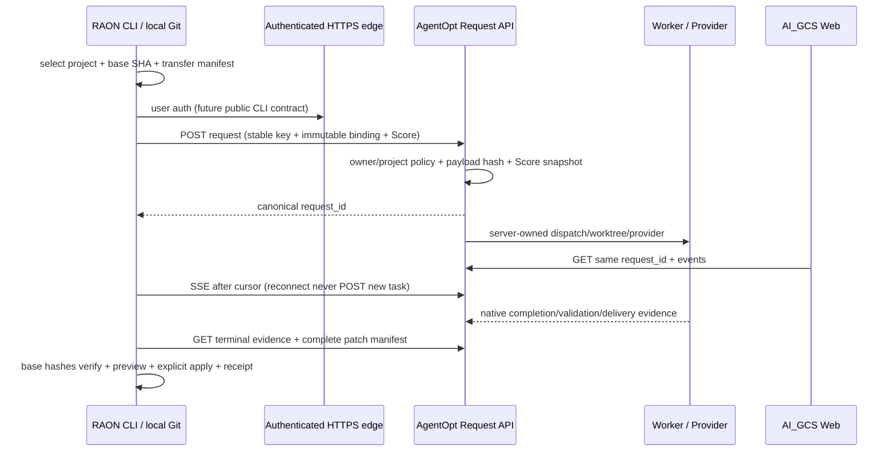

> RAON 분석 추가: 2026-10-04 UTC. 분석 전용, 배포물이 아님. Goose source pin `591edd47cf2cfea4957d720c607cf2a4def8673d`. 사실(F), 설계 제안(P), 미검증(U)을 구분한다. 아래 upstream 경로는 모두 이 SHA 기준이며 [source evidence](evidence/source_manifest.json)에 파일 해시와 검색 위치가 있다.

# Four integration options

점수는 설계 평가(P)이며 runtime benchmark가 아니다. 1=매우 불리/대수술, 3=추가 계약 필요, 5=가장 적합. 동일 요구조건과 서버 canonical execution을 가정한다. B는 config/extension/provider adapter 수준을 유지한 경우, D는 Goose server 그대로가 아니라 AgentOpt ACP facade + custom client를 구현한 경우다. canonical ownership/credential/egress는 hard gate로 평균점수로 상쇄할 수 없다.

| 기준 | A full fork | B custom distro | C selective thin CLI | D ACP facade/client |
|---|---:|---:|---:|---:|
| canonical Request | 3 | 1 | 5 | 4 |
| Web/CLI 동일 조회 | 3 | 2 | 5 | 4 |
| local Git UX | 3 | 3 | 4 | 3 |
| Windows | 3 | 4 | 4 | 3 |
| provider credential 중앙화 | 3 | 3 | 5 | 5 |
| Provider egress 서버 소유 | 3 | 2 | 5 | 5 |
| source privacy | 2 | 2 | 4 | 4 |
| offline/local-only Git | 4 | 4 | 4 | 3 |
| streaming | 4 | 4 | 5 | 4 |
| approval UX | 3 | 3 | 4 | 4 |
| idempotency | 2 | 1 | 5 | 3 |
| retry/resume | 3 | 2 | 5 | 3 |
| validation/evidence | 2 | 1 | 5 | 3 |
| Agent.Tools Score binding | 2 | 1 | 5 | 3 |
| cross-project isolation | 2 | 2 | 5 | 4 |
| upstream sync 비용(높을수록 유리) | 1 | 5 | 4 | 4 |
| build/release/signing 비용 | 1 | 2 | 4 | 3 |
| 보안 공격면 | 1 | 2 | 5 | 4 |
| 구현 복잡도 | 1 | 4 | 3 | 2 |
| 장기 유지비 | 1 | 3 | 4 | 3 |

동일 가중치 총점(100점 만점): A 47, B 51, C 90, D 71. B는 canonical hard gate를 통과하지 못한다. offline 점수는 로컬 Git UX만 의미하며 오프라인 모델 실행은 제공하지 않는다.

A: CLI+agent/state_machine/providers/session/MCP/updater/packaging까지 유지하고 execution을 바꾸면 upstream 빠른 변경과 강한 충돌. 기능이 풍부해도 원치 않는 local autonomy를 감사해야 한다.

B: `CUSTOM_DISTROS.md`는 config/branding/declarative provider/MCP 중심 customization을 공식 설명한다. 하지만 builder가 Agent를 직접 생성한다. REST adapter를 provider처럼 감싸면 local loop가 남으며 validation/Request 의미를 손실한다. core rewrite를 더하면 더 이상 여기서 평가한 configuration-focused B가 아니다. hard gate FAIL.

C: goose-cli 전체 crate 링크가 아니라 terminal input/output/stream buffering/completion의 작은 부분을 own neutral API로 추출한다. Git transactional contract는 신규 AgentOpt module이다. 원본 CLI의 Git product를 그대로 가져오는 것이 아니므로 구현 비용은 3. 직접 canonical API와 SSE를 사용해 identity를 유지하고 Electron/GDK/provider closure를 피한다. **추천**.

D: ACP는 editor interoperability가 필요할 때 가치가 있다. `goose serve`를 그대로 실행하면 Goose execution이 남으므로 FAIL. AgentOpt가 ACP server가 되면 REST 위에 mapping/metadata/cursor/idempotency/artifacts/approval facade를 추가해야 한다. 최소 CLI 목표에는 C보다 비용이 크다. protocol이 hard gate 의미를 전달하는 PoC가 입증되면 장기 선택지.

C의 최소성: first slice는 Mode 1의 status/watch/result/evidence + bounded diff/apply다. generic clap/rustyline/console를 직접 써도 비용이 더 낮다면 Goose 코드 재사용을 줄일 수 있다. 이 판단은 Goose를 반드시 기반으로 삼겠다는 약속이 아니다. build graph와 extraction 비용을 후속 PoC에서 비교한다.

## Canonical sequence (P)

향후 Local Runner는 Worker가 서명한 bounded task에 응답하는 capability이며 별도 scheduler가 아니다. Web에서 시작한 Request도 같은 GET/SSE/evidence 계약으로 CLI에서 조회하도록 한다. 실제 상호운용은 후속 acceptance에서 검증한다.
